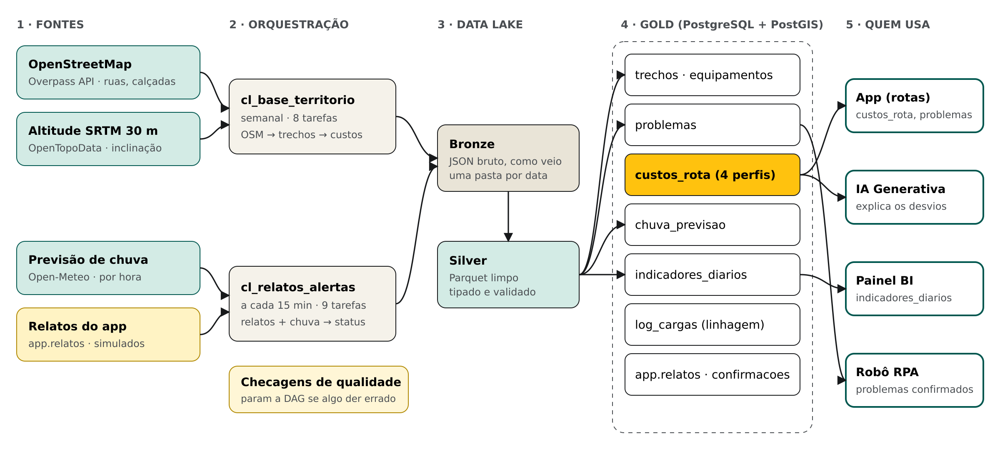

# Caminho Livre · Pipeline de Dados

> **FIAP Global Solution 2026.2 · CitizenTech**
> Disciplina de Big Data

O **Caminho Livre** é um "Waze para pedestres" acessível: ele calcula rotas a pé que respeitam as limitações de cada pessoa (cadeira de rodas, idosos, pessoas com deficiência visual) usando dados abertos e relatos da comunidade.

Este repositório contém o **pipeline de dados** do produto: ele coleta, trata e carrega os dados que alimentam o cálculo das rotas.

📄 **Documentação completa:** [docs/Caminho_Livre_Big_Data.pdf](docs/Caminho_Livre_Big_Data.pdf)

---

## Ficha Técnica do MVP

| Item | Descrição |
|---|---|
| **Produto** | Caminho Livre, rotas a pé acessíveis |
| **Problema** | Calçadas sem rampa, buracos, obras, ladeiras e alagamentos tornam a cidade inacessível, e os mapas comuns não mostram isso |
| **Público** | Pessoas em cadeira de rodas, idosos, pessoas com deficiência visual e pedestres em geral |
| **Solução de dados** | Pipeline que combina mapa aberto, relevo, previsão de chuva e relatos da comunidade para calcular o custo de cada trecho de calçada para cada perfil |
| **Região do MVP** | Região central de Osasco (SP) |
| **Orquestração** | Apache Airflow 2.10.5 |
| **Armazenamento** | Data lake em camadas (bronze JSON, silver Parquet) e PostgreSQL 16 + PostGIS (gold) |
| **Linguagem** | Python 3.12 (pandas, pyarrow, pyproj, requests, psycopg2) |
| **Infraestrutura** | Docker Compose |
| **Fontes** | OpenStreetMap (Overpass API), OpenTopoData SRTM 30 m, Open-Meteo e relatos simulados |

---

## Arquitetura



O pipeline segue a **arquitetura medalhão**:

| Camada | Onde fica | Formato | O que guarda |
|---|---|---|---|
| **Bronze** | `data/lake/bronze/<fonte>/dt=AAAA-MM-DD/` | JSON | Resposta original de cada API, sem alteração |
| **Silver** | `data/lake/silver/<tabela>/dt=AAAA-MM-DD/` | Parquet | Dados limpos e padronizados |
| **Gold** | PostgreSQL + PostGIS | Tabelas | Trechos, custos por perfil, problemas e indicadores prontos para o app |

Cada execução gera arquivos com data e hora no nome, então o histórico nunca é sobrescrito.

---

## Fontes de dados

| Fonte | O que fornece | Frequência |
|---|---|---|
| **OpenStreetMap** (Overpass API) | Calçadas, travessias, rampas, piso e equipamentos (UBS, escolas, pontos de ônibus) | Semanal |
| **OpenTopoData** (SRTM 30 m) | Altitude para calcular a inclinação de cada trecho | Semanal |
| **Open-Meteo** | Previsão de chuva por hora | A cada 15 min |
| **Relatos simulados** | Problemas relatados por usuários e confirmações de outros usuários | A cada 15 min |

---

## DAGs

### `cl_base_territorio` (semanal)

Monta a base do território: o mapa de calçadas com inclinação e custos.

```
criar_tabelas → extrair_osm → transformar_trechos → extrair_altitude
→ calcular_inclinacao → carregar_gold → checar_qualidade → calcular_custos
```

### `cl_relatos_alertas` (a cada 15 minutos)

Processa os relatos da comunidade e a previsão de chuva, e recalcula os custos.

```
simular_uso_do_app → extrair_relatos → consolidar_status → carregar_problemas ─┐
                                                                               ├→ recalcular_custos → checar_qualidade → calcular_indicadores
                     extrair_chuva → carregar_chuva ───────────────────────────┘
```

Os ramos de relatos e de chuva rodam **em paralelo** e se juntam no recálculo dos custos.

---

## Regras principais

- **Custo por perfil:** cada trecho tem um custo para os perfis padrão, cadeira, idoso e visual (comprimento × fatores). O custo **-1** significa trecho bloqueado.
- **Inclinação:** acima de **8,33%** (limite da NBR 9050) o trecho é bloqueado para cadeira de rodas. Trechos com menos de 30 m ficam sem inclinação, porque o SRTM tem um ponto a cada 30 m e geraria ladeiras falsas.
- **Ciclo de vida do relato:** `novo` → `em_verificacao` → `confirmado` (3 pessoas confirmam) ou `descartado` (2 respostas negativas ou validade expirada).
- **Validade dos relatos:** alagamento 6 h, obstáculo 48 h, iluminação 15 dias, buraco 30 dias, obra 60 dias, falta de rampa 180 dias.
- **Chuva:** classificada pelos limites da AMS (fraca, moderada, forte). Chuva forte prevista entra no cálculo dos custos.

---

## Resultados (execução de 18/11/2026)

| Indicador | Valor |
|---|---|
| Trechos de calçada processados | 422 |
| Equipamentos encontrados | 11 |
| Trechos bloqueados para cadeira de rodas (inclinação + problemas confirmados) | 60 (14,2%) |
| Trechos bem mapeados no OSM (completude ≥ 0,75) | 32,0% |
| Relatos recebidos no dia (simulados) | 80 |
| Problemas confirmados pela comunidade | 50 |
| Relatos descartados | 13 |
| Rede liberada para cadeira de rodas | 32,55 km |

Só 1 em cada 3 trechos tem informação completa no OpenStreetMap. Isso justifica o modelo colaborativo do Caminho Livre: a comunidade completa o que o mapa aberto não tem.

---

## Qualidade, linhagem e LGPD

- **Qualidade:** cada DAG tem uma tarefa de checagem (geometrias inválidas, trechos sem comprimento, status válidos etc.). Se uma checagem falha, a tarefa falha e o problema aparece no Airflow.
- **Linhagem:** cada carga é registrada em `gold.log_cargas` (tarefa, tabela, número de linhas e horário). O bronze guarda a resposta original de cada API.
- **LGPD:** nenhum nome, telefone ou e-mail é armazenado. O usuário é um identificador anônimo (`usuario_hash`). As senhas ficam só no arquivo `.env`, que não vai para o GitHub.

---

## Estrutura do repositório

```
caminho-livre-dados/
├── dags/                  # DAGs do Airflow
│   ├── dag_base_territorio.py
│   └── dag_relatos_alertas.py
├── src/pipeline/          # Código do pipeline (extração, transformação, carga, qualidade)
├──
